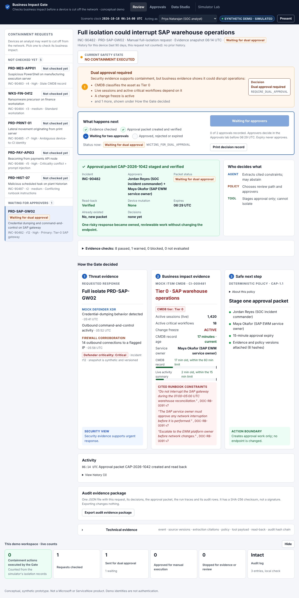

# Business Impact Gate — Containment Assurance (synthetic prototype)

A pre-flight safety gate for **manual, high-impact containment** in a Defender XDR–style SOC. Before an analyst fully isolates a device, the Gate reconciles security evidence with customer-owned operational truth — CMDB tier and ownership, live dependencies, change freezes and cited runbook constraints — and, when business impact cannot be ruled out, stages **one read-back-verified dual-approval packet**. It never isolates, revokes or reconfigures anything.

> **Conceptual and synthetic.** Not a Microsoft or ServiceNow product. Every company, person, incident, count and timestamp is invented. "Mock Microsoft Security" and "Mock ITSM/CMDB" are local behavioural simulators, not the vendor APIs. Demo identities are not authentication.



## Quick start

Requires Node.js ≥ 22.13 (uses the built-in `node:sqlite`; no native build step). Built and tested on Node 22.22.

```bash
npm install
npm run seed        # create data/runtime/{security,itsm,gate}.db from the synthetic scenario (also happens on first start)
npm run dev         # API + simulators on http://127.0.0.1:4300, UI on http://127.0.0.1:5173
```

Open **http://127.0.0.1:5173**. No credentials, keys or network access are needed.

Production-style single process: `npm run build && npm run build:server && npm start` → UI and API both on http://127.0.0.1:4300 (start auto-bootstraps empty stores, then runs the compiled server).

| Command | What it does |
|---|---|
| `npm run seed` | Reset all three stores to the synthetic seed |
| `npm run dev` | API (tsx watch) + Vite dev server with `/api` proxy |
| `npm start` | Bootstrap (idempotent) + compiled API/server; serves `app/dist` if built. Needs `npm run build:server` first |
| `npm run typecheck` / `npm run lint` | `tsc --noEmit` (strict) / ESLint |
| `npm test` | Vitest unit + integration (252 tests) |
| `npm run build` | Vite production build of the React app |
| `npm run secret-scan` | Fails if secrets/server config reach the bundle or source |
| `npm run test:e2e` | Playwright browser tests (32, two server projects) against the built app; run `npm run build` first |
| `npm run verify` | All of the above in order |
| `npm run generate:workbooks` | Regenerate the sample workbook, CSVs and import fixtures |

If Playwright cannot download its browser in your environment, set `PW_CHROMIUM_PATH` to any Chromium/Chrome binary.

## Three-minute demo (Excel → decision → verified outcome)

0. **First visit.** Review opens with a three-line story and one button, **Show me the PRD-SAP-GW02 example**, which runs the steps below for you.
1. **Review → PRD-SAP-GW02 → Prepare isolation review.** Within 30 seconds the screen answers: requested action (*Full isolate PRD-SAP-GW02*), why it's risky (Tier 0, 1,420 live sessions, 18 active critical workflows, active change freeze, cited runbook line), the decision (`REQUIRE_DUAL_APPROVAL`) and the safety state (*No containment executed*).
2. **Send for dual approval** (the primary button in *What happens next*; it says what it will do before you click). One HTTP call to the ITSM simulator creates `CAP-2026-1042`; the Gate reads it back, re-checks the device, and only then shows `RESPONSE_READY → WAITING_FOR_DUAL_APPROVAL`, *Read-back VERIFIED*, *Device mutation NONE*. Open **Technical evidence** for the real trace (every HTTP attempt), policy input, evidence hashes, tool payload and hash-chained audit.
3. **Approvals.** Switch *Acting as* to Jordan Reyes (incident commander) → Approve; switch to Maya Okafor (SAP owner) → Approve. Back on Review the request is `APPROVED_FOR_MANUAL_EXECUTION` and the device is still not isolated — approval authorizes the analyst; execution stays in Defender.
4. **Excel changes the outcome.** Review → PRD-MES-APP01 → Prepare: `INSUFFICIENT_EVIDENCE` (CMDB record ~9 h old). **Data Studio** → import `fixtures/imports/files/valid-fix-stale-mes-cmdb.xlsx` → preview shows `CI-007120 (updated: lastVerifiedAt)` → confirm → commit (1 row re-read and verified). Back on Review → **Re-evaluate**: now `REQUIRE_DUAL_APPROVAL` with the MES owner as approver.
5. **Failure and recovery.** **Simulator Lab** (demo controls, outside the Gate) → *Reset scenario*, then under *Failure drills* *ITSM write commits but response times out* → back on Review, prepare and stage the SAP gateway: the first attempt times out, the retry returns the existing packet (`duplicate=true`), and exactly one packet exists. Try *ITSM corrupts the next read-back*: the Gate refuses to claim success → `VERIFICATION_FAILED`. Under *Advanced simulator controls*: *Concurrent incident update* before staging → `STALE_INCIDENT_VERSION`, re-evaluate, stage. *Advance clock +16 min* → the packet expires; expiry never approves.

Reset any time from **Simulator Lab → Reset scenario** or `npm run seed`.

**Presenting?** The **Present** toggle in the header enlarges the text, hides the Simulator Lab and pins the live counts (*Containment actions executed by the Gate: 0*, computed from the simulator's records). **Print decision record** on any review prints a one-request summary marked as synthetic.

Product clarity and UX plan (business case, issue tree, accessibility targets): [docs/PRODUCT-UX-PLAN.md](docs/PRODUCT-UX-PLAN.md) · investor one-pager: [docs/INVESTOR-ONE-PAGER.md](docs/INVESTOR-ONE-PAGER.md).

## Scenarios shipped

| Queue item | Scenario | Decision |
|---|---|---|
| PRD-SAP-GW02 · INC-90482 | Primary: Tier-0 SAP gateway, freeze, runbook owner approval | `REQUIRE_DUAL_APPROVAL` |
| PRD-MES-APP01 · INC-90483 | CMDB record stale (> 60 min) | `INSUFFICIENT_EVIDENCE` |
| WKS-FIN-0412 · INC-90484 | Tier-3 workstation, no dependencies | `STANDARD_RESPONSE_ELIGIBLE` (Gate still executes nothing) |
| PRD-PRINT-01 · INC-90485 | Two CIs claim the device | `INSUFFICIENT_EVIDENCE` |
| PRD-PAY-API03 · INC-90486 | Defender STANDARD vs CMDB Tier 1 + prompt injection in alert and runbook | `REQUIRE_DUAL_APPROVAL` (injection ignored) |
| PRD-HIST-07 · INC-90487 | Runbook contradicts itself on owner approval | `MANUAL_REVIEW` (extractor abstains) |

## Operating modes

| Mode | Behaviour |
|---|---|
| `SIMULATED` (default) | Gate → HTTP → local stateful simulators. Fully runnable offline. |
| `SANDBOX` | Selects Microsoft Graph/Defender and ServiceNow adapter **placeholders**. Missing credentials → setup error. With credentials they still fail closed (`ADAPTER_NOT_VERIFIED`) — they never return simulated data. UI offers an explicit switch back to SIMULATED. |
| `LIVE` | Same placeholders; additionally requires `ENABLE_LIVE_INTEGRATIONS=true`. Never selected implicitly. |

Optional model-backed extractor: `EXTRACTOR_PROVIDER=anthropic` + `ANTHROPIC_API_KEY` + `EXTRACTOR_MODEL_ID` (server-side only). Not verified against a live model in this build; its output passes the same strict schema and verbatim-citation checks. See [docs/INTEGRATIONS.md](docs/INTEGRATIONS.md).

## Troubleshooting

- **Happy path suddenly says `CMDB_STALE`/`ACTIVITY_STALE`:** the default dev clock *ticks* from 06:14 UTC; after ~15 real minutes the live-activity summary is legitimately stale. Reset the scenario, or run with `CLOCK_MODE=frozen`.
- **"Evaluation expired" when staging:** evidence older than 5 scenario-minutes must be re-read. Click *Re-evaluate*.
- **Setup required banner:** you started in SANDBOX/LIVE or selected the model extractor without config. Click *Switch to SIMULATED mode* or fix `.env`.
- **Port in use:** set `PORT` (API) — the Vite proxy follows it. E2E uses `E2E_PORT` (default 4310).
- **E2E can't launch a browser:** `PW_CHROMIUM_PATH=/path/to/chromium npm run test:e2e`.

## Documentation

[Architecture](docs/ARCHITECTURE.md) · [Simulator contracts](docs/SIMULATOR-CONTRACTS.md) · [Data import guide](docs/DATA-IMPORT-GUIDE.md) · [Integrations](docs/INTEGRATIONS.md) · [Requirements traceability](docs/REQUIREMENTS-TRACEABILITY.md) · [Implementation status](docs/IMPLEMENTATION-STATUS.md) · [Test report](docs/TEST-REPORT.md) · [Decision log](docs/DECISION-LOG.md) · [Portfolio case study](docs/PORTFOLIO-CASE-STUDY.md) · [Interview guide](docs/INTERVIEW-GUIDE.md) · [Deployment](docs/DEPLOYMENT.md) · [Access and analytics](docs/ACCESS-AND-ANALYTICS.md) · [V3 change report](docs/V3-CHANGE-REPORT.md)
